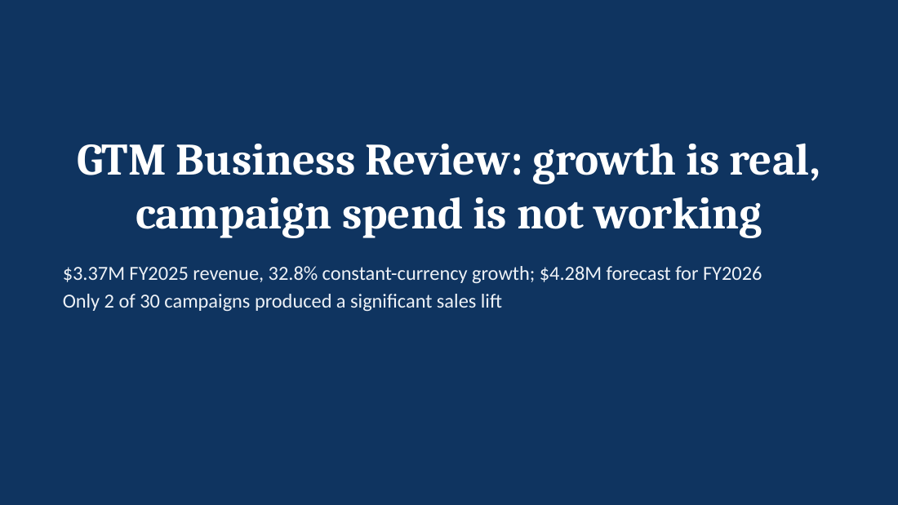
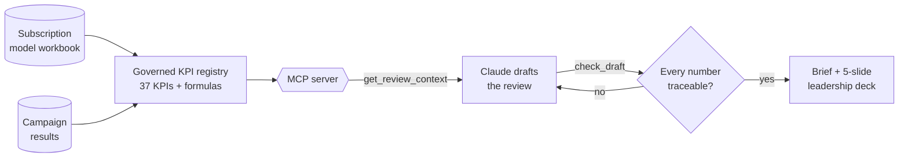
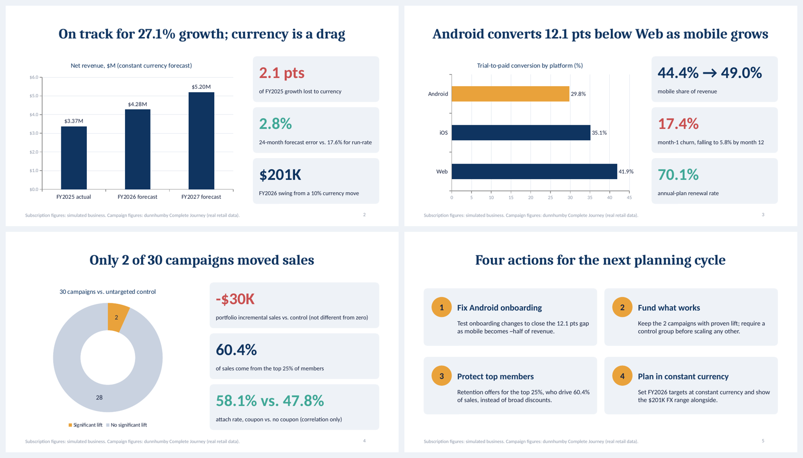

<div align="center">

# GTM Business Review Agent

**Let Claude draft the leadership business review. Make sure every number in it is true.**

[](https://github.com/achux11/gtm-business-review-agent/actions/workflows/ci.yml)




</div>

---

## Why this exists

AI can turn a dashboard into a polished leadership brief in seconds. It can also round a number the wrong way, mix up two metrics, or invent one, and a single wrong figure in front of leadership costs more credibility than the whole brief earns.

This project keeps the speed and removes that risk:

| | |
|---|---|
| 📚 **Governed KPIs** | 37 KPIs (plus 4 analysis definitions), each with a definition, unit, source and display format. Derived metrics carry their formula. |
| 🔌 **MCP server for Claude** | Claude pulls approved numbers and drafting rules through tools, instead of having numbers pasted into a prompt. |
| ✅ **Number checker** | Every figure in a draft is traced back to a KPI, allowing only the rounding implied by how it is written. |
| 📊 **Leadership deck** | A 5-slide business review generated only from numbers that passed the checker. |

## How it works



## The checker in action

A draft with two subtle mistakes:

> *FY2025 revenue hit **$3.5M**, up 30.7%. Web converts at 41.9% vs. 29.8% on Android, and we ran **285K** trials. Only 2 of 30 campaigns worked.*

```json
{
  "numbers_checked": 7,
  "supported": 5,
  "unsupported": [
    { "text": "$3.5M", "note": "not traceable to any governed KPI" },
    { "text": "285K",  "note": "not traceable to any governed KPI" }
  ],
  "ready_to_share": false
}
```

Revenue was **$3.37M**, not $3.5M. And 285,585 trials rounds to **286K**, so "285K" is quietly wrong; "285K+" passes.

| Draft says | Result | Why |
|---|---|---|
| "Web converts at 41.9%" | ✅ Supported | Matches `conv_web` (41.88%) at one decimal |
| "Web converts at 43%" | ❌ Unsupported | No KPI rounds to 43% |
| "Portfolio sales were -$30K" | ✅ Supported | Matches `camp_portfolio_incremental` |
| "Month-1 churn in Q4 2026" | ➖ Ignored | Labels and years are not metrics |

## The deck it produces



**Storyline:** growth is real (on track for 27.1%), Android converts 12.1 pts below Web as mobile grows, only 2 of 30 campaigns moved sales, and four actions for the next planning cycle. Download: [`outputs/gtm_business_review.pptx`](outputs/gtm_business_review.pptx)

## MCP tools

| Tool | What it does |
|---|---|
| `list_kpis(domain)` | All governed KPIs, or one domain (`subscription`, `campaign`, `definition`) |
| `get_kpi(kpi_id)` | One KPI with its definition, source and display format |
| `get_review_context()` | KPIs grouped into 4 themes, plus drafting rules |
| `check_draft(text)` | Checks every number; returns what is unsupported and `ready_to_share` |

Resources: `gtm://drafting-rules` · `gtm://reference-brief`

## Quick start

```bash
pip install -r requirements.txt
pytest -q                  # 15 tests, including an end-to-end MCP client test
python export_review.py    # writes the validated brief to outputs/
npm install && npm run deck  # builds outputs/gtm_business_review.pptx
```

<details>
<summary><b>Connect it to Claude Desktop</b></summary>

Add this to `claude_desktop_config.json` (use your own paths), then restart Claude Desktop:

```json
{
  "mcpServers": {
    "gtm-business-review": {
      "command": "/path/to/python",
      "args": ["/path/to/gtm-business-review-agent/server.py"]
    }
  }
}
```

Then ask:

> *Use gtm-business-review to draft a one-page business review for leadership, then run check_draft and fix anything unsupported.*

</details>

## Data

| Domain | Source | Type |
|---|---|---|
| Growth, funnel, churn, currency | [subscription-revenue-cohort-model](https://github.com/achux11/subscription-revenue-cohort-model) workbook | Simulated business |
| Campaigns, member value | [loyalty-promotion-roi](https://github.com/achux11/loyalty-promotion-roi) published results | Real retail data (dunnhumby *The Complete Journey*) |

## Project layout

```
gtm_review/kpis.py      governed KPI registry (workbook + campaign results + derived formulas)
gtm_review/validate.py  number checker
gtm_review/brief.py     review context, drafting rules, reference brief
server.py               MCP server (4 tools, 2 resources)
export_review.py        validated brief -> outputs/
build_deck.js           5-slide deck from the validated brief
tests/                  15 tests
```

## Limitations

- The checker confirms a number traces to a KPI, not that it is used in the right sentence. A correct number in the wrong context can still pass, so a person still reads the final draft.
- The subscription business is simulated. Campaign figures come from the published results table, not recomputed here.
- Analysis settings (the 10% currency scenario, top-25% cut-off, month 12, 24-month horizon) are registered as definitions so they can appear in text.

---

<div align="center">

Built by **Achintya Vamshi Nudurupati** · [GitHub](https://github.com/achux11) · [LinkedIn](https://linkedin.com/in/achintya11)

</div>
